<!-- readme-standard: 2026-11-02 -->
<div align="center">



# 🌵 PIR® Changelog & Library

*A running, public-safe record of what's shipped for Psychedelics In Recovery™, and the library behind it.*

[](LICENSE)
[](https://psychedelicsinrecovery.github.io/changelog-astro-public/)

[](https://code.claude.com/docs/en/overview)


 **You are here:** PIR® › source `changelog-astro` (private) → twin `changelog-astro-public` (public) · `main` is the working branch

</div>

##  TL;DR

1.  **What this is.** A plain-language, dated record of what has shipped for [psychedelicsinrecovery.org](https://www.psychedelicsinrecovery.org), with a `/library` of write-ups for the curious. This file is also the live site's homepage.
2.  **Who it is for.** Someone outside the fleet who wants to know what changed and why it mattered.
3.  **Do this first.** [Read the live site](https://psychedelicsinrecovery.github.io/changelog-astro-public/). To add an entry, create `changelog/YYYY-MM-DD-short-slug.md`.

> A running, public-safe record of what's shipped for Psychedelics In Recovery™ — plus a growing
> library of the deeper technical write-ups behind it, for anyone who wants to actually understand
> how this all works.


---

<strong><i class="ph ph-door-open"></i> <a href="https://psychedelicsinrecovery.github.io/changelog-astro-public/">Changelog &amp; Library Astro Porch →</a></strong>

<a href="https://psychedelicsinrecovery.github.io/"><i class="ph ph-arrow-square-out"></i> Entry portal</a> ·
<a href="https://psychedelicsinrecovery.github.io/changelog-astro-public/changelog"><i class="ph ph-clock-counter-clockwise"></i> Changelog</a> ·
<a href="https://psychedelicsinrecovery.github.io/changelog-astro-public/library"><i class="ph ph-books"></i> Library</a>

---

## 👋 What this is

This is the private source for PIR®'s public changelog site — a plain-language, dated record of
what's actually shipped for [psychedelicsinrecovery.org](https://www.psychedelicsinrecovery.org),
plus a `/library` of deeper technical write-ups for the curious. No debugging trails, no internal
jargon — written for someone outside the fleet who wants to know what changed and why it mattered.

This README is also rendered as the live site's own homepage — so if you're reading this on the
website, 👋 hi, same file.

🪞 Reading this on GitHub in `changelog-astro-public`? That repo is the automatic, **read-only public mirror**: the
site is built from the private source and pushed there, so changes are made at the source.

## 🗂️ What's here

- `changelog/` — one markdown file per shipped entry, `YYYY-MM-DD-short-slug.md`. Kept as a sibling
  of `astro/`, never inside it, so the sync workflow's source-strip step keeps this repo's history
  private — only the compiled HTML reaches the public repo.
- `library/` — deeper, standalone technical docs that don't belong to one changelog entry.
- `astro/` — the Astro site itself: content collections, pages, layout.
- `.github/workflows/sync-public.yml` — builds the site, strips everything except the compiled
  output, and pushes it to
  [`psychedelicsinrecovery/changelog-astro-public`](https://github.com/psychedelicsinrecovery/changelog-astro-public).

Built from the fleet-wide `my-template/changelog-template/` pattern — that directory's own
`README.md` is the actual spec: the frontmatter schema, the "confirmed-done goes straight to
changelog" convention, and why the public repo lives under the `psychedelicsinrecovery` org instead
of a personal `drasticstatic` repo.

## ✍️ Adding an entry

New file in `changelog/`, named `YYYY-MM-DD-short-slug.md`:

```yaml
---
title: "Plain-language title"
date: "YYYY-MM-DD"
priority: "P1-high" # or P2-medium (default) or P3-low
repo: "wordpress" # which project this entry belongs to
---

Body in plain language — what shipped and why it mattered. Not a debugging trail; that stays in
pir-wp-live's own private technical docs.
```

Push to `main` and the sync workflow rebuilds and republishes automatically.

##  Suggest a change

Noticed something? Type `/techcom` in [PIR®'s Discord](https://discord.gg/MyprTq8w95). Members with access can open an [issue](https://github.com/psychedelicsinrecovery/changelog-astro/issues) or a pull request against `main`; TechCom reads them and a person with the role merges. The source is private, so a visitor sees a 404 there.

## 📄 License
- 💻 **Code:** MIT, see [`LICENSE`](LICENSE)
- 📝 **Written content** (docs, changelog and library prose, READMEs): CC BY-SA 4.0, see [`LICENSE-CONTENT`](LICENSE-CONTENT)
- 🏷️ **Names, logos and marks:** not covered by either license, see [`TRADEMARKS.md`](TRADEMARKS.md)

---

*Maintained by [psychedelicsinrecovery](https://github.com/psychedelicsinrecovery) · w/ Anthropic's Claude Code CLI*

Co-Authored-By: Alfred · ClaudeCodeCLI · Anthropic [Sonnet-5]

<sub>The front door follows the living [README standard](https://github.com/drasticstatic/my-template/blob/main/README-STANDARD.md). Copy it, improve it.</sub>
